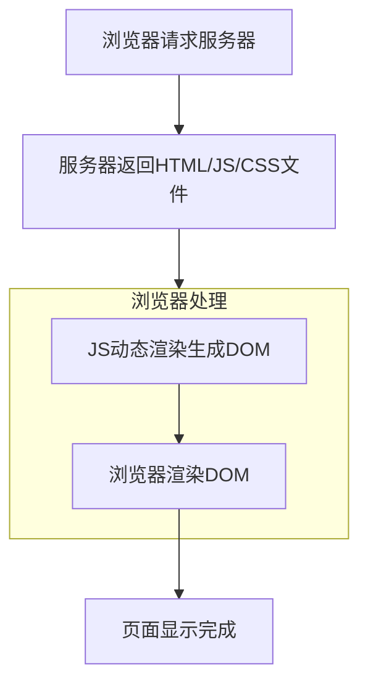
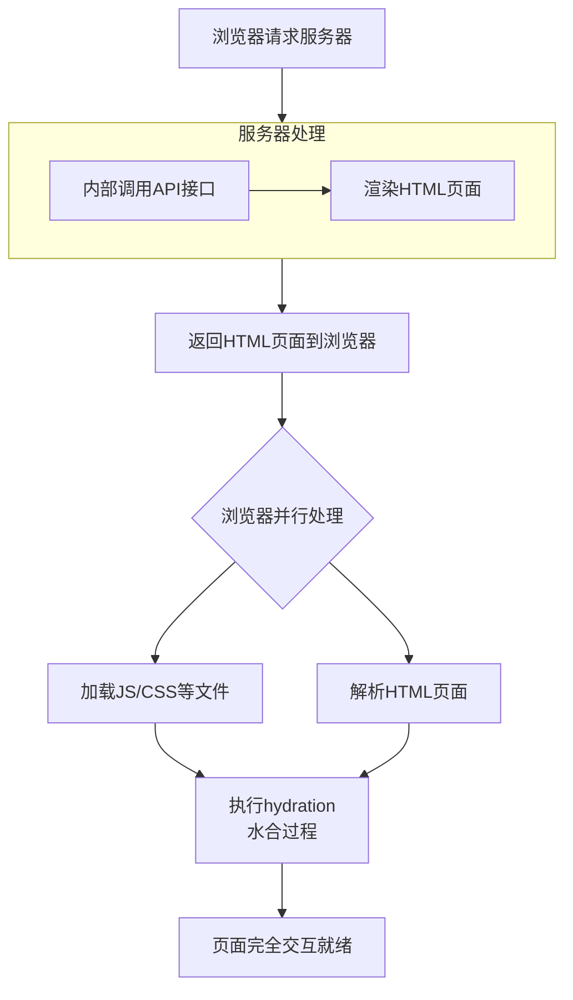
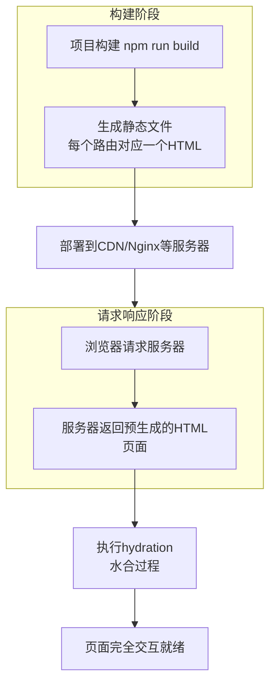
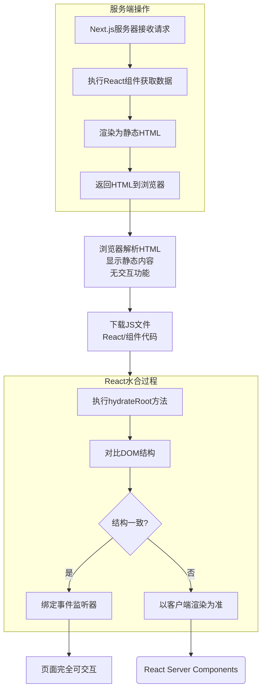

# Next.js学习笔记

## 前言

### 为什么选择Next.js

1. 用的人多

2. SSR服务端渲染技术

3. SEO搜索引擎优化

4. AI产品研发[AI-SDK]

### 前置知识条件:

1. HTML,CSS,JavaScript

2. TypeScript

3. React

4. Node.js

**视频链接:** <a href="https://www.bilibili.com/video/BV1P9CxBsEUA">Next.js(16) + AI</a>

## 搭建项目

### 脚手架安装

使用npm脚手架搭建

```bash
npx create-next-app@latest #npm 包管理器
```

或者:

```bash
pnpm dlx create-next-app@latest #pnpm包管理器
```

### 关键配置项

1. `TypeScript`:现代前端项目工程化语言,用于取代JavaScript提供更好的类型检查

2. `Linter`:根据方案识别并报告 ECMAScript/JavaScript 代码问题的工具，其目的是使代码风格更加一致并避免错误。

3. `React Compiler`:自动完成React应用中组件和Hooks的缓存化,于25年10月7日发布首个稳定版

4. `TailwindCSS`:CSS原子化

5. `App Router`:项目的路由系统

### 目录

- `node_modules`:npm依赖

- `src/app`:应用代码
  
  - `layout.tsx`:根布局组件
  
  - `page.tsx`:主页,应用页面

- `next.config.ts`:项目配置文件

- `package.json`:项目依赖配置

- `postcss.config.mjs`:PostCSS配置

- `tsconfig.json`:TypeScript配置文件

### 启动项目

- **启动**

```bash
pnpm run dev
```

- **编译生成环境**

```bash
pnpm run build
```

### OneMoreThings

1. 什么是Turbopack?

使用Rust编写的打包工具,性能是webpack的700倍

好处?

1. 统一环境,统一依赖图关系

2. 惰性打包,只打包开发服务器请求的内容,减少首次启动时间

3. 增量计算,多线程计算+函数级缓存,一旦完成就不再重新重复计算直到函数被更新
   
   

2. 什么是React Compiler?

自动添加`useMemo`,`useCallback`,`React.memo`,减少心智负担.

可通过添加`babel-plugin-react-compiler`依赖,在nextConfig中设置开启.


3. 什么是App Router?什么是Page Router?
- 都是基于文件系统的路由

在传统的框架中,路由需要通过路由表手动配置,而Next.js使用了自动的配置方式

- `Page Router`: 将`pages`目录下所有的`jsx/tsx`文件都转换成路由,如`pages/index.tsx`会转换成`/`.**问题:** 不能把任何组件写到`pages`目录下,需要通过`_Component`的方式才能排除路由

- `App Router`: 根据约束定义:
  
  - `src/app/page.tsx`: / 首页
  
  - `layout.tsx`: 布局组件
  
  - `template.tsx`: 模版组件
  
  - `loading.tsx`:加载组件
  
  - `error.tsx`:错误组件
  
  - `not-found.tsx`:404组件
  
  - `/subpage/page.tsx`: `/subpage`子路由页面

- `Page Router`读取数据使用`getServerSideProps`,`getStaticProps`,`getStaticPaths`等函数,而`App Router`则不需要,使用`fetch`即可

## 路由导航

路由导航指的是在Nextjs中实现页面跳转的方式,在Next.js中共有四种方式提供跳转.

- `Link`组件

- `useRouter`Hooks函数(客户端组件)

- `redirect`函数(服务端组件)

- `History API` Web API标准

### Link组件

`<Link>`是一个内置组件,在a标签的基础上拓展了`prefetch`,`scroll`等功能

```tsx
import Link from "next/link";

export default function About() {
  return (
    <div className="flex min-h-screen items-center justify-center bg-zinc-50 font-sans dark:bg-black">
      <main className="flex min-h-screen w-full max-w-3xl flex-col items-center justify-center py-32 px-16 bg-white dark:bg-black sm:items-start">
        <h1 className="max-w-xs text-3xl font-semibold leading-10 tracking-tight text-black dark:text-zinc-50">
          This is the About Page.
        </h1>

        <Link href='/'
        className="flex h-12 w-full items-center justify-center rounded-full border border-solid border-black/[.08] px-5 transition-colors hover:border-transparent hover:bg-black/[.04] dark:border-white/[.145] dark:hover:bg-[#1a1a1a] md:w-[158px]">
        Home
        </Link>
      </main>
    </div>
  );
}
```

#### 携带查询参数

写法: `href={{pathname:'/about/me',query:{id:1}}}`

获取查询参数:`useSearchParams()`

使用`searchParams.get()`/`searchParams.getAll()`获取查询参数

使用`...has()`判断查询字段是否存在

*``useSerachParams``是客户端函数,只能在客户端组件生效*

**注意:** 使用`useSearchParam`的组件需要包裹在`<Suspense></Suspense>`的组件内，在Next.js中，推荐在`layout.tsx`配置相关布局。

```tsx
'use client';
import Link from "next/link";
import {useSearchParams} from 'next/navigation';
export default function About() {

    const searchParams = useSearchParams();
    const id = searchParams.get('id'); //返回字符串 
    const ids = searchParams.getAll('id'); //返回数组
    const isId = searchParams.has('id') //返回布尔值
    console.log('Query id:', id);


  return (
    <div className="flex min-h-screen items-center justify-center bg-zinc-50 font-sans dark:bg-black">
      <main className="flex min-h-screen w-full max-w-3xl flex-col items-center justify-center py-32 px-16 bg-white dark:bg-black sm:items-start">
        <h1 className="max-w-xs text-3xl font-semibold leading-10 tracking-tight text-black dark:text-zinc-50">
          This is the About Page.
        </h1>

        <Link href='/'
        className="flex h-12 w-full items-center justify-center rounded-full border border-solid border-black/[.08] px-5 transition-colors hover:border-transparent hover:bg-black/[.04] dark:border-white/[.145] dark:hover:bg-[#1a1a1a] md:w-[158px]">
        Home
        </Link>
      </main>
    </div>
  );
}
```

#### prefetch预加载

语法:`prefetch:{true}`

启用后会在浏览器访问到当前组件后预加载Link指向的页面内容

#### scroll保持滚动位置

语法：`scroll:{true}` **默认开启**

启用后可以保持跳转到的新页面始终为最顶端开始滚动

#### replace舍弃历史记录

语法: `replace`

启用后舍弃先前的历史跳转记录


### useRouter Hooks

`useRouter`可以在代码中根据逻辑跳转页面，但它必须使用在客户端组件中，须声明为`'use client'`

- **`Page Router`** -> **`next/router`**

- **`App Router`** -> **`next/navigation`**

#### router.push

`router.push(href: string, { scroll: boolean })` : 执行客户端导航至提供的路由。会在浏览器的历史记录栈中添加一个新条目。

#### router.prefetch

`router.prefetch(href: string, options?: { onInvalidate?: () => void })` : [预获取](https://nextjs.org/docs/app/getting-started/linking-and-navigating#prefetching)提供的路由，以实现更快的客户端切换。当[预获取的数据过期](https://nextjs.org/docs/app/guides/prefetching#extending-or-ejecting-link)时，可选的 `onInvalidate` 回调函数将被调用。

#### router.refresh

`router.refresh()`：刷新当前路由。向服务器发起新的请求，重新获取数据并重新渲染服务器组件。客户端将合并更新后的 React 服务器组件数据，而不会丢失未受影响的客户端 React 状态（例如 `useState`）或浏览器状态（例如滚动位置）。

#### router.back

`router.back()`：导航回浏览器历史记录中的上一个路由。

#### router.forward

`router.forward()`：导航到浏览器历史记录中的下一个页面。

#### router.replace

`router.replace(href: string, { scroll: boolean })` : 执行客户端导航至提供的路由，但不会在浏览器的历史记录栈中添加新条目。

### redirect函数

#### `redirect`函数

`redirect` 函数允许你将用户重定向到另一个 URL。你可以在 [服务器组件](https://nextjs.org/docs/app/getting-started/server-and-client-components) 、 [路由处理程序](https://nextjs.org/docs/app/api-reference/file-conventions/route) 和 [服务器操作](https://nextjs.org/docs/app/getting-started/updating-data) 中调用 `redirect`。

`redirect` 通常在执行变更或事件后使用。例如，创建一篇文章时：

```ts
'use server'

import { redirect } from 'next/navigation'
import { revalidatePath } from 'next/cache'

export async function createPost(id: string) {
  try {
    // Call database
  } catch (error) {
    // Handle errors
  }

  revalidatePath('/posts') // Update cached posts
  redirect(`/post/${id}`) // Navigate to the new post page
}
```

> **注意事项** ：
> 
> * `redirect` 默认返回 307（临时重定向）状态码。在 Server Action 中使用时，返回 303（查看其他），这通常用于在 POST 请求后重定向到成功页面。
> * `redirect` 会抛出错误，因此在使用 `try/catch` 语句时，应将其调用在 `try` 块 **之外** 。
> * `redirect` 可以在客户端组件的渲染过程中调用，但不能在事件处理程序中调用。你可以改用 [`useRouter` 钩子](https://nextjs.org/docs/app/guides/redirecting#userouter-hook) 。
> * `redirect` 还接受绝对 URL，可用于重定向到外部链接。
> * 如果希望在渲染过程之前进行重定向，请使用 [`next.config.js`](https://nextjs.org/docs/app/guides/redirecting#redirects-in-nextconfigjs) 或 [代理](https://nextjs.org/docs/app/guides/redirecting#nextresponseredirect-in-proxy) 。


#### `permanentRedirect`函数

`permanentRedirect` 函数可将用户**永久**重定向到另一个 URL。您可以在 [服务器组件](https://nextjs.org/docs/app/getting-started/server-and-client-components) 、 [路由处理程序](https://nextjs.org/docs/app/api-reference/file-conventions/route) 和 [服务器操作](https://nextjs.org/docs/app/getting-started/updating-data) 中调用 `permanentRedirect`。

`permanentRedirect` 通常在执行更改实体规范 URL 的操作或事件后使用，例如用户更改用户名后更新其个人资料 URL：

```ts
'use server'

import { permanentRedirect } from 'next/navigation'
import { revalidateTag } from 'next/cache'

export async function updateUsername(username: string, formData: FormData) {
  try {
    // Call database
  } catch (error) {
    // Handle errors
  }

  revalidateTag('username') // Update all references to the username
  permanentRedirect(`/profile/${username}`) // Navigate to the new user profile
}
```

> **注意事项** ：
> 
> * `permanentRedirect` 默认返回 308（永久重定向）状态码。
> * `permanentRedirect` 还接受绝对 URL，可用于重定向到外部链接。
> * 如果希望在渲染过程之前进行重定向，请使用 [`next.config.js`](https://nextjs.org/docs/app/guides/redirecting#redirects-in-nextconfigjs) 或 [代理](https://nextjs.org/docs/app/guides/redirecting#nextresponseredirect-in-proxy) 。

## 动态路由

### 基本用法

1. 创建[Params]文件夹，若要捕获多个参数则写作`[...Params]`，若表示可选参数可写作`[[...optional]]`

2. 在该文件夹下创建客户端组件`page.tsx`

3. 使用`useParams`Hooks获取参数,使用解耦或赋值的方式获取路径参数

```tsx

// src/app/about/[id]/page.tsx
'use client'

import { useParams } from 'next/navigation';

export default function AboutPage() {

    const params = useParams();
    const id = params.id;
    console.log('Dynamic Route id:', id);

    return (
        <>
            <div className="h-500 flex min-h-screen items-center justify-center bg-zinc-50 font-sans dark:bg-black">
                <main className="flex min-h-screen w-full max-w-3xl flex-col items-center justify-center py-32 px-16 bg-white dark:bg-black sm:items-start">
                    <h1 className="max-w-xs text-3xl font-semibold leading-10 tracking-tight text-black dark:text-zinc-50">
                        This is the About Page with ID: {id}
                    </h1>
                </main>
            </div>


        </>

    )


}
```

## 平行路由

平行路由指的是在同一个布局中渲染多个页面，类似`Vue Router`的`Router-View`

平行路由允许你在同一布局中同时或有条件地渲染一个或多个页面。它们适用于应用程序中高度动态的区域，例如仪表板和社交网站的动态信息流。

### 基本方法

1. 在`src/app`下创建`@slot`文件夹

2. 在`@slot`文件夹下编写`page.tsx`和`default.js`

3. 在`layout.tsx`中定义和引入插槽。

**注：** 

- 在最新的`Next.js`中**必须**在`@slot`文件下创建`default.js`用于渲染失败。[File-system conventions: default.js | Next.js](https://nextjs.org/docs/app/api-reference/file-conventions/default)

- 在平行路由中，设置形如`loading.tsx`等友好提示页面是允许的。

- 在平行路由下，也可以继续配置路由导航。（软导航只会更新活跃内容，直接输入URL或刷新的硬导航会导致404）

```js
//default.js


import { notFound } from 'next/navigation'

export default function Default() {
  notFound()
}
```

```tsx
// ./src/app/layout.tsx
import type { Metadata } from "next";
import { Geist, Geist_Mono } from "next/font/google";
// @ts-ignore
import "./globals.css"

const geistSans = Geist({
  variable: "--font-geist-sans",
  subsets: ["latin"],
});

const geistMono = Geist_Mono({
  variable: "--font-geist-mono",
  subsets: ["latin"],
});

export const metadata: Metadata = {
  title: "Create Next App",
  description: "Generated by create next app",
};

export default function RootLayout({
  children,
  home
}: Readonly<{
  children: React.ReactNode;
  home: React.ReactNode;

}>) {
  return (
    <html lang="en">
      <body
        className={`${geistSans.variable} ${geistMono.variable} antialiased`}
      >
        {children}
        {home}
      </body>
    </html>
  );
}


```

## 路由组

路由组是一种基于文件夹的约定范式，可以按类别或团队定义组织路由模块，并且不影响URL路径。


### 使用方法

1. 在`src/app`下创建`(routergroup)`文件夹

2. 在`(routergroup)`文件夹根目录下创建`layout.tsx`

3. 在`(routergroup)`文件夹内创建相关文件夹路由和页面`page.tsx`

4. 在路由组文件夹根目录下的`layout.tsx`中插值子元素

## 路由处理程序

Route Handlers 允许你使用 Web [Request](https://developer.mozilla.org/docs/Web/API/Request) 和 [Response](https://developer.mozilla.org/docs/Web/API/Response) API 为指定路由创建自定义请求处理程序。


> **需要注意** ：Route Handlers 仅可在`App Router`中使用。它们相当于 `pages` 目录中的 [API Routes](https://nextjs.org/docs/pages/building-your-application/routing/api-routes)，不可同时的使用 API Routes 和 Route Handlers。

### 使用方法

1. 在`src/app`根目录下创建`api`文件夹

2. 在`api`文件夹内的子文件夹创建`route.ts`

3. 在`route.ts`中引入`NextRequest`和`NextResponse`方法，编写 `RESTful API` ，其函数名必须为**全大写的HTTP请求方法**

```ts
// next-app/src/app/api/user/route.ts

import { NextRequest,NextResponse } from "next/server";

export async function GET(request:NextRequest) {
    return NextResponse.json({message:'Hello, User!'});

}
```

```http
GET http://localhost:3000/api/user HTTP/1.1

HTTP/1.1 200 OK
vary: rsc, next-router-state-tree, next-router-prefetch, next-router-segment-prefetch
content-type: application/json
Date: Fri, 02 Jan 2026 13:33:07 GMT
Connection: close
Transfer-Encoding: chunked

{
  "message": "Hello, User!"
}

```

### 查询参数

使用`const query = request.nextUrl.searchParams`获取查询对象，通过`query.get()`或`query.getAll()`方法获取字段值

### POST请求

可使用标准**Web API** 方法，`formData()`方法读取请求体

```ts

export async function POST(request:NextRequest) {

    const data = await request.json();

    console.log('Received data:', data);
    return NextResponse.json({message:'User data received'},{status:201});

}
```

### 动态路由

有时候网页项目中已使用了动态路由，此时须

1. 在相关路由文件夹下创建`[params]`的文件夹

2. 在该文件夹内创建`route.ts`文件

3. 通过`{params}`获取参数

*注:* 从Next.js v15开始 `context.params`字段**是`Promise`对象** ，须配合`await`获取参数。

```ts
// next-app/src/app/api/user/[id]/route.ts

import { NextRequest,NextResponse } from "next/server";

export async function GET(request:NextRequest,{params}: {params:Promise<{id:string}>}) {

    const {id} = await params;
    console.log('User ID:', id);
    return NextResponse.json({message:`Hello, User with ID: ${id}`});

}
```

## Cookies

`cookies` 是一个 **异步**函数，可在 [服务器组件](https://nextjs.org/docs/app/getting-started/server-and-client-components) 中读取 HTTP 请求的 Cookie，也可在 [服务器操作](https://nextjs.org/docs/app/getting-started/updating-data) 或 [路由处理程序](https://nextjs.org/docs/app/api-reference/file-conventions/route) 中读取和写入出站请求的 Cookie。

### 使用方法

[功能: cookies | Next.js](https://nextjs.org/docs/app/api-reference/functions/cookies)

以下方法可用：

| 方法                          | 返回类型 | 描述                                      |
| --------------------------- | ---- | --------------------------------------- |
| `get('name')`               | 对象   | 接受一个 cookie 名称，并返回包含名称和值的对象。            |
| `getAll()`                  | 对象数组 | 返回所有名称匹配的 cookie 列表。                    |
| `has('name')`               | 布尔值  | 接受一个 cookie 名称，并根据该 cookie 是否存在返回一个布尔值。 |
| `set(name, value, options)` | -    | 接受一个 cookie 名称、值和选项，并设置传出请求的 cookie。    |
| `delete(name)`              | -    | 接受一个 cookie 名称并删除该 cookie。              |
| `toString()`                | 字符串  | 返回 cookies 的字符串表示形式。                    |

### 选项

设置 Cookie 时，以下 `options` 对象中的属性是受支持的：

| 属性            | 类型                               | 描述                                                       |
| ------------- | -------------------------------- | -------------------------------------------------------- |
| `name`        | 字符串                              | 指定 cookie 的名称。                                           |
| `value`       | 字符串                              | 指定要存储在 cookie 中的值。                                       |
| `expires`     | 日期                               | 定义 Cookie 的确切过期日期。                                       |
| `maxAge`      | 数字                               | 以秒为单位设置 Cookie 的生命周期。                                    |
| `domain`      | 字符串                              | 指定 Cookie 可用的域名。                                         |
| `path`        | 字符串，默认值：`'/'`                    | 将 Cookie 的作用域限制在域名内的特定路径。                                |
| `secure`      | 布尔值                              | 确保仅通过 HTTPS 连接发送 Cookie，以增强安全性。                          |
| `httpOnly`    | 布尔值                              | 将 Cookie 限制为仅 HTTP 请求，防止客户端访问。                           |
| `sameSite`    | 布尔值，`'lax'`，`'strict'`，`'none'`  | 控制 Cookie 的跨站点请求行为。                                      |
| `priority`    | 字符串（`"low"`，`"medium"`，`"high"`） | 指定 Cookie 的优先级                                           |
| `partitioned` | 布尔值                              | 指示 Cookie 是否为 [分区](https://github.com/privacycg/CHIPS) 。 |

唯一具有默认值的选项是 `path`。

### 示例(登录功能)

```ts
// next-app/src/app/api/login/route.ts

import {NextRequest,NextResponse} from 'next/server';
import{ cookies} from 'next/headers';
export async function POST(request: NextRequest) {
    const body = await request.json();
    if(body.username ==='admin'&& body.password ==='123456'){
        const cookieStore = await cookies();
        cookieStore.set('token','1234567890',{
            httpOnly: true,
            maxAge: 60 * 60 * 24 * 30, // 30 day
        });
        return NextResponse.json({message:'Login successful',code:1});
    }else{
        return NextResponse.json({message:'Invalid credentials',code:0}, {status:401});
    }
}

export async function GET() {
    const cookieStore = await cookies();
    const token = cookieStore.get('token');
    if(token && token.value ==='1234567890'){
        return NextResponse.json({message:'User is authenticated',code:1});
    } else {
        return NextResponse.json({message:'User is not authenticated',code:0}, {status:401});
    }
}
```

## AI-SDK

Vercel开发的AI-SDK，用于构建AI产品和工具。

由于本篇内容与Next.js关系不大，故在此贴上链接。

[AI SDK by Vercel](https://ai-sdk.dev/docs/introduction)

[Next.js(AI-SDK)_哔哩哔哩_bilibili](https://www.bilibili.com/video/BV1P9CxBsEUA?p=9&vd_source=75123c5d6ddf7add04ab0e96d5ddb1f7&spm_id_from=333.788.videopod.episodes)

## Proxy

> 从 Next.js 16 开始，Middleware 现在被称为 Proxy，以更准确地反映其用途。功能保持不变。

可通过命令一步升级

### 使用方法

- 处理跨域请求

- 接口转发

- 配合第三方实现限流

- 鉴权
  
  

```ts
// ./src/proxy.ts
import {NextRequest, NextResponse} from 'next/server';

export async function proxy(request: NextRequest) {
    console.log(request.url)
}

// matcher: '/home/:path*'
export const config = {
    matcher: '/proxy/:path*'
};
```

### 请求器Matcher

- `source`:匹配源路径

- `has`:匹配条件

- `missing`:不匹配条件

- `type`:拦截类型,可选`cookie`,`header`,`query`

- `key/value`:键值对

[请求器Matcher| Next.js](https://nextjs.org/docs/app/api-reference/file-conventions/proxy#matcher)

### 处理跨域

```ts
// ./src/proxy.ts
import {NextRequest, NextResponse} from 'next/server';
import { ProxyConfig } from 'next/server';

const corsHeaders = {
    'Access-Control-Allow-Origin': '*',
    'Access-Control-Allow-Methods': 'GET,POST,PUT,DELETE,OPTIONS',
    'Access-Control-Allow-Headers': 'Content-Type, Authorization',
};
export async function proxy(request: NextRequest) {
    const response = NextResponse.next();
    const cookies = request.headers.get('cookie') || '';
    Object.entries(corsHeaders).forEach(([key, value]) => {
        response.headers.set(key, value);
    });

    if(cookies){
        return response;}
    return NextResponse.redirect(new URL('/', request.url));
    console.log(request.url)
}

// matcher: '/home/:path*'
export const config = {
    matcher: '/proxy/:path*'
};
```

## 渲染基础

本章我们学习 `CSR` `SSR` `SSG` 三种渲染方式,以及`Hydration`水合的概念。

### CSR

CSR是`Client Side Rendering`的缩写，即客户端渲染。像我们使用的`Vue` `React` `Angular` 等框架，都是CSR。

工作流程如下：

浏览器请求服务器 -> 服务器返回HTML/JS/CSS等文件 -> JS动态渲染生成DOM -> 浏览器渲染DOM



优点：

* 交互流畅，可直接响应
* 前后端分离，前端注重UI，后端注重数据

缺点：

* 首屏加载慢，因为需要下载JS/CSS等文件
* SEO不友好，因为JS动态渲染`(现在爬虫普遍已经支持JS抓取了)`

适合场景：

* 后台管理系统开发(后台系统不需要SEO，也不需要首屏加载速度)
* 单页面应用开发(SPA)

### SSR

SSR是`Server Side Rendering`的缩写，即服务端渲染。像我们使用的`Next.js` `Nuxt.js`等框架，都是SSR。

例如我们有一个电商网站，需要保证用户搜索关键词能搜到 `xx商品`, 还要注意 用户还可能是`弱网环境`,在地铁 电梯等，所以我们可以直接把API放到服务器请求，然后渲染成HTML页面返回给浏览器。

工作流程如下：



优点：

* 首屏加载快，因为服务器已经渲染了HTML页面
* SEO友好，搜索引擎能爬取到完整内容

缺点：

* 开发成本高，需要懂服务端知识，全栈开发。
* 服务器承担渲染工作，如果用户访问量大，对服务器配置要求高，增大成本

适合场景：

* 电商网站开发
* 博客网站开发
* 官网/首页等

### SSG

SSG是`Static Site Generation`的缩写，即静态站点生成。像我们使用的`Vitepress` `Astro`等框架，都是SSG。

例如我们需要一个查看文档的网站，例如`Vue` `React` 等文档，大家看到的都是一样的，所以我们在构建的时候，直接编译成静态文件，连接口都不用请求了，如果在部署CDN/Nginx等服务器，基本可以实现秒开。

工作流程如下：

项目构建 `npm run build` -> 生成静态文件（每个路由对应一个 HTML） -> 部署到CDN/Nginx等服务器 -> 浏览器请求服务器 -> 服务器返回HTML页面 -> hydration




优点：

* 首屏加载极快（CDN 分发静态文件，无需服务器实时渲染）
* 服务器压力小（CDN 直接承载请求，无需服务器执行 JS）
* SEO 最优（静态 HTML 含完整数据，搜索引擎爬取无压力）

缺点：

* 不适用于动态数据（数据更新需要重新构建部署，如实时股价、实时评论）
* 详情页面如果过多(构建时间会长)

适合场景：

* 技术文档
* 静态营销页
* 静态新闻站

### Hydration(水合)

简单来说就是HTML他是静态的，需要通过JS才能变成动态的，不然HTML是没有任何交互效果的，当JS下载完成在赋予HTML交互效果的阶段称之为`水合`。

以Next.js水合为例(详细版本):

服务端操作:

* Next.js 服务器接收到用户请求。
* 服务器执行 React 组件代码，获取数据（比如从 API 接口请求文章列表）。
* 服务器将 React 组件渲染成静态 HTML 字符串（包含了文章列表的所有内容）。
* 服务器将这个 HTML 字符串返回给浏览器。

客户端操作:

* 浏览器接收到 HTML，立即解析并展示给用户（此时用户能看到文章列表，但点击 “查看详情” 按钮没有反应）
* 浏览器开始下载页面所需的 JS 文件（包括 React 核心库、组件代码等）
* JS 下载完成后，React 会执行 ReactDOM.hydrateRoot() 方法（在 React 18+ 中）
* hydrateRoot() 会对比浏览器中的真实 DOM 和 React 组件的虚拟 DOM：
  * 如果结构一致，React 会给真实 DOM 绑定事件监听器。
  * 如果发现差异（比如服务器和客户端数据不一致），React 会发出警告，并以客户端渲染的结果为准。
* 水合完成后，页面变成可交互的动态页面（用户可以点击按钮、滚动加载更多内容等）



## RSC(服务器组件)

RSC(服务器组件)是React19`正式引入`的一种新的组件类型，它可以在服务器端渲染，也可以在客户端渲染。

像传统的`SSR`他是在服务器提前把页面渲染好，然后返回给浏览器，然后进行水合，`CSR`则是在客户端渲染，而`RSC`则是吸取两方优势，分为`服务器组件`和`客户端组件`。

举个例子:

例如我们有一个官网的页面，上面都是静态内容，但下面留言框是需要交互的。


此时我们就可以拆分成两个组件:

* 服务器组件: 上面都是静态内容，例如正文，标题，图片等，这类组件之所以适合在服务端执行，核心原因在于服务端渲染HTML+CSS的速度更快，生成的内容对搜索引擎完全可见，且无需客户端额外处理交互逻辑，完美匹配静态内容的需求。
  
  ```tsx
      //Next.js 默认服务器组件
    export default function HomePage() {
  
        return (
            <div>
                <h1>Home Page</h1>
            </div>
        )
  
    }
  ```

* 客户端组件: 下面留言框是需要交互的，例如交互功能，如点赞按钮、计数器、表单等。这类组件需要依赖浏览器DOM事件、状态管理（useState）、副作用（useEffect）等客户端能力，必须在客户端完成渲染和水合（即添加事件处理程序的过程）才能实现交互效果
  
  ```tsx
      'use client' //声明这是一个客户端组件
    export default function HomePage() {
  
        return (
            <div>
                <h1>Home Page</h1>
            </div>
        )
  
    }
  ```

### 渲染(RSC Payload)

SSR模式是在服务器直接渲染成`HTML`页面，返回给浏览器的，而`RSC`他是一种特殊的紧凑的格式

那为什么这么做呢？因为我们的组件可以进行嵌套服务器组件嵌套客户端组件>

黄色节点表示`服务器组件`，虚线节点表示`客户端组件` 

在这个结构中，Next.js就会标记哪些是客户端组件并且预留好位置，但是不会进行水合。

那么Next.js发现客户端组件也会在服务器生成这个结构，那干脆直接服务器里面把客户端组件进行预渲染(不包含交互)，这样我们就能快速看到数据，等他加载完成后再进行水合，所以客户端组件也会在服务器进行一次`预渲染`。

### 优点

* 将组件拆分成客户端组件和服务器组件，可以有效的减少`bundle`体积，因为`服务器组件`已经在服务器渲染好了，所以没必要打入`bundle`中,也就是说服务器组件所依赖的包都不会打进去，大大减少了`bundle`体积。

* 局部水合，像传统的SSR同构模式, 所有的页面都要在客户端进行水合，而`RSC`将组件拆分出来，只会把客户端组件进行水合，避免了全量水合带来的性能损耗。

* 流式加载，我们的HTML页面本来就支持流式加载，所以服务器组件可以边渲染边返回，提高了FCP(首次内容绘制)性能。

## 服务端组件与客户端组件

```tsx
// 服务端组件
import fs from 'node:fs' //引入fs模块
import mysql, { RowDataPacket } from 'mysql2/promise' //操作数据库 仅供演示 非最佳实践
const pool = mysql.createPool({
    host: 'localhost',
    user: 'root',
    password: '123456',
    database: 'catering',
})

export default async function ServerPage() {
    const [rows] = await pool.query<RowDataPacket[]>('SELECT * FROM goods')
    const data = fs.readFileSync('data.json', 'utf-8')
    const json = JSON.parse(data)
    return (
        <div>
            <h1>Server Page</h1>
            {json.age}///{json.name}///{json.city}
            <h3>mysql</h3>
            {rows.map((item: any) => (
                <div key={item.id}>{item.name}-{item.goodsPrice}</div>
            ))}
        </div>
    )
}
```

### 服务端组件的优点

- 安全性:在服务端组件访问的API key不会暴露给客户端

- 体积：服务端组件在服务端渲染，所以不会打包到客户端

- 全栈：可以在服务端组件访问数据库，调用Nodejs的API，体积更小

- **FCP**：因为服务端组件是流式传输，提高了FCP的性能(看HTTP请求头`Transfer-Encoding: chunked`)

### 无法使用服务端组件的条件

1. 需要交互性的场景
   
   - 事件处理：onClick、onChange、onSubmit 等
   
   - 状态管理：useState、useReducer
   
   - 生命周期副作用：useEffect、useLayoutEffect
   
   - DOM 引用：useRef 用于 DOM 元素

2. 浏览器专属 API

3. 特定 React Hooks
   
   - useState
   - useReducer
   - useEffect、useLayoutEffect
   - useImperativeHandle
   - 自定义 hooks 依赖上述 hooks

4. 第三方库依赖浏览器环境
   
   - 图表库（如 D3.js、Chart.js）
   - 地图库（如 Leaflet、Google Maps）
   - 富文本编辑器
   - 动画库（如 Framer Motion、GSAP）

5. 路由相关的 hooks: `useRouter()`、`usePathname()`、`useSearchParams()`.(使用 `navigation` 替代或移入客户端组件)

6. 动态数据取决于客户端状态
   
   ```tsx
   // ❌ 不能依赖实时客户端数据
   function Component() {
   const [time, setTime] = useState(new Date()); // 需要客户端
   return <div>{time.toLocaleTimeString()}</div>;
   }
   ```

### 客户端组件

在`jsx/tsx`头部添加`'use client'`标志即可

**注:** 

- 在浏览器环境下,首次加载客户端组件会自动的进行**预渲染**,尝试渲染DOM界面以备`React`水合，再次刷新或加载时则不会再进行预渲染。

- 客户端组件并不能嵌套服务端组件（原因是服务端组件可能调用了Node.js运行时或其他第三方依赖的函数，但浏览器并不具备与Node.js一致的运行时。）

- 部分API可能是通用的例如`fetch`

### 区分服务端和客户端的`fetch`

#### 安装

```bash
npm i server-only
```

#### 使用

```ts
import 'server-only'
export default function useTest(type:0|1){
    if(type === 0){
    return fetch('https://api.github.com')
    }else{
    return new     WebSocket('wss://api.github.com')
    }
}
```

## 缓存组件(Cache Components)

### 什么是Cache Components

Cache Components 是Next.js(16)版本特有的机制，实现了`静态内容` `动态内容` `缓存内容`的混合编排。保留了静态内容的加载速度，又具备动态渲染的灵活性，解决了`静态内容(加载快但无法实时更新数据)`和`动态内容(加载慢但可以实时更新数据)`权衡的问题。

* 静态内容: 构建(`npm run build`)时进行预渲染，例如 `「本地文件」「模块导入」「纯计算」（无网络请求、无用户相关数据）`,会被直接编译成`HTML`瞬间加载、立即响应。

* 动态内容：用户发起请求时才开始渲染的内容，依赖 “实时数据” 或 “用户个性化信息”，每次请求都可能生成不同结果，不会被缓存。例如`「实时数据源」（如实时接口、数据库实时查询）或「用户请求上下文」（如 Cookie、请求头、URL 参数）`。

* 缓存内容：缓存内容的本质就是缓存动态数据，缓存之后会被纳入`静态外壳(Static Shell)`,静态外壳就类似于`毛坯房`，会提前把结构搭建好，后续在通过(流式传输)填充里面的动态内容。

| 传统方案                 | Cache Components      |
| -------------------- | --------------------- |
| 静态页面：数据无法实时更新        | 支持缓存内容重新验证，动态内容流式补充   |
| 动态页面：初始加载慢、服务器压力大    | 静态外壳优先返回，动态内容并行渲染     |
| 客户端渲染：bundle 体积大、首屏慢 | 服务器预渲染核心内容，客户端仅补充动态部分 |

### 启用方法

须更新到`Next.js 16+` 

在`next.cofig.ts`中 设置

```ts
import type { NextConfig } from "next";


const nextConfig: NextConfig = {
    cacheComponent: true,
};


export default nextConfig;
```

### 注意事项

- 对可能产生不同结果的动态内容如`Math.random()`，须使用`await connection()`避免缓存组件渲染错误，该组件**必须**被父组件`<Suspense></Suspense>`包裹。

### 缓存内容

对动态请求进行缓存,在动态请求的函数前一行使用`'use cache'`的注解字段。

如果需要预设缓存时间，可以调用`cacheLife(profile)`函数来制定缓存时间。

#### `cacheLife`函数

> 引用地址：[Functions: cacheLife | Next.js](https://nextjs.org/docs/app/api-reference/functions/cacheLife)

缓存配置文件通过三个与时间相关的属性来控制缓存行为：

* `stale`：客户端在未与服务器通信的情况下，可以使用缓存数据的最长时间

* `revalidate`：在这段时间之后，下一次请求会触发后台数据的更新（即数据的重新加载）

* `expire`: 如果在这段时间内没有收到任何请求，系统会等待新的请求到来，以便获取最新的内容

---


- `stale`
  客户端方面： 客户端可以在不与服务器通信的情况下使用缓存的数据多长时间。
  在这段时间内，客户端路由器会立即显示缓存中的内容，而无需发送任何网络请求。当这个缓存有效期结束后，路由器必须在下一次用户导航或发送请求时与服务器进行通信以获取最新数据。
  这种方式可以实现快速的页面加载（因为数据来自客户端缓存），但缓存中的数据可能会过时。

- `revalidate`
  服务器在后台重新生成缓存内容的频率。
  当请求在此时间段之后到达时，服务器：
  
  1. 立即提供缓存版本（如果可用）
  2. 在后台重新生成内容
  3. 使用新内容更新缓存
     类似于 增量静态再生（ISR）

- `expire`
    缓存内容必须重新生成之前的最大时间。
    在此无流量的时段过后，服务器将在下一个请求时同步重新生成内容，当你同时设置 `revalidate` 和 `expire` 时，`expire` 的值必须大于 `revalidate`。Next.js 会验证此配置，并对无效配置抛出错误。

#### `catchLife`预设参数

| Profile | 适用场景          | stale | revalidate | expire |
| ------- | ------------- | ----- | ---------- | ------ |
| seconds | 实时数据（股票、比分）   | 30秒   | 1秒         | 1分钟    |
| minutes | 频繁更新（社交动态）    | 5分钟   | 1分钟        | 1小时    |
| hours   | 每日多次更新（库存、天气） | 5分钟   | 1小时        | 1天     |
| days    | 每日更新（博客文章）    | 5分钟   | 1天         | 1周     |
| weeks   | 每周更新（播客）      | 5分钟   | 1周         | 30天    |
| max     | 很少变化（法律页面）    | 5分钟   | 30天        | 1年     |

*感觉改编一下就可以当JS手撕题了？*

## 组件

### Image组件

`<Image>`是`Next.js`的内置组件，相较于原生的`img`实现了更多的拓展功能，相较于原生标签，它的优势在于：

- **尺寸优化**：对现代图片格式支持更好，根据设备自动提供正确的尺寸，自动对本地图像进行优化`webp`

- **视觉稳定性**：防止图片加载导致的布局位移

- **懒加载**：利用浏览器原生特性实现懒加载，可按需添加占位符

- **灵活性**：按需调整图像大小，即便是远程服务器上的图像也可以

#### 写法

> **参考:** [Components: Image Component | Next.js](https://nextjs.org/docs/app/api-reference/components/image)

```tsx
import Image from 'next/image'

export default function Page() {
  return (
    <Image
      src="/profile.png"
      width={500}
      height={500}
      alt="Picture of the author"
    />
  )
}
```

- `loading`：用于控制图片的加载时机。
  
  * ``lazy``：将图片的加载延迟到它距离视口达到某个预设距离时才进行。
  * ``eager``：无论图片在页面上的位置如何，都会立即加载该图片。

- `preload`：预加载

- `width={} height={}`：设置宽高【**必填**】

- `src="path/to/pic"`：资源路径，通过多种方式引入。
  
  - 字符串路径URL
  - 通过`import img1 from @public/1.png`的方式引入，随后传入引用对象。
  - 使用`await`异步获取对象，使用`img.default`属性获取。`const img1 = await import('@public/1.png')`

- `sizes`：用于定义图像在不同屏幕分辨率（即“断点”）下的显示尺寸。浏览器会根据这些尺寸信息，从生成的 ``srcset`` 文件中选择最合适的图像版本进行显示。

- `quality`：该值是一个介于`1-100`之间的整数，用于设置优化后图像的质量。数值越高，文件大小和视觉效果越好；数值越低，文件大小会减小，但图像的清晰度可能会受到影响。

#### 跨域配置

Next.js框架下默认不能直接获取跨域网址的图像,需要额外在`next.config.ts`中配置。

```ts
import type { NextConfig } from "next";

const nextConfig: NextConfig = {
  /* config options here */
  images:{
    remotePatterns:[
      {
        protocol: 'https',
        hostname: 's21.ax1x.com',
        port: '',
        pathname: '/**',
      }
    ]
  }
};

export default nextConfig;

```

> 详情参见：[next/image未配置host](https://nextjs.org/docs/messages/next-image-unconfigured-host)
> 
> 对于像 `https://example.org/images/example?v=1234` 这样的 URL，其各个部分必须符合您所配置的模式要求
> 
> * **协议（Protocol）**：`http` 与 `https` 必须完全匹配。
> * **主机名（Hostname）**：`example.org` 与 `www.example.org` 以及像 `assets.example.org` 这样的子域名是不同的。
> * **端口（Port）**：如果存在（例如 ``:3000``），则必须将其包含在内。
> * **路径名（Pathname）**：该路径必须被你的通配符规则所覆盖；例如，可以使用 ``/**`` 或 ``/images/**``。
> * **搜索**：如果在模式中指定了该参数，那么它必须与整个搜索字符串完全匹配（包括开头的 `?`）。搜索过程中不支持使用通配符（globs）。

#### 策略配置

* `deviceSizes`：允许你指定一组设备屏幕宽度的阈值。当 `next/image` 组件使用 `sizes` 属性时，这些宽度值会被用来确保为用户设备提供合适的图片。如果没有提供任何配置，将使用以下默认值：

```javascript
module.exports = {
  images: {
    deviceSizes: [640, 750, 828, 1080, 1200, 1920, 2048, 3840],
  },
}
```

* `imageSizes`：允许你指定一组图片的宽度值。这些宽度值会与 `设备尺寸` 数组合并，从而形成用于生成图片 `srcset` 的完整尺寸数组。如果没有提供任何配置，将使用以下默认值：

```javascript
module.exports = {
  images: {
    imageSizes: [32, 48, 64, 96, 128, 256, 384],
  },
}
```

`imageSizes` 仅用于那些提供了 `sizes` 属性的图片；该属性表示该图片的宽度小于屏幕的完整宽度。因此，`imageSizes` 中列出的所有尺寸都必须小于 `deviceSizes` 中的最小尺寸。


### Font组件

`next/font`模块内置了字体优化功能，目的是防止**CLS**布局偏移，支持`Google Fonts`和导入本地字体。

> - **什么是CLS:** **CLS（累计布局偏移）** 是 Google 提出的 **Core Web Vitals（核心网页性能指标）** 之一，用于衡量**页面在生命周期内发生“非用户主动触发”的布局位移程度**。
> 
> - **为什么会发生CLS:** 浏览器在初次布局时，无法准确预知某些资源最终占用的空间
> 
> - **发生CLS的可能原因:**
> 1. 字体加载
> 
> 2. 图片/视频未声明尺寸(Next.js要求非本地`src`源的Image必须要宽高的原因)
> 
> 3. DOM的异步更新
> 
> 4. 动态样式 / JS 操作布局
> - **CLS的消极影响：** 
>   
>   - 用户体验不佳，易误操作
>   
>   - SEO 排名下降，转化率下降
>   
>   - CLS本身就伴随着可能的技术问题
> 
> - **Next.js如何解决CLS问题：**
> 1. 构建期分析字体 Metrics，提取字体关键参数，计算字体空间分布
> 
> 2. 生成字体等效fallback css
> 
> 3. 字体内联 + 本地托管，不依赖第三方CDN，允许preload和tree-shaking
> 
> 4. SSR注入字体样式


#### 用法

1. 通过`next/font/google`引入内置谷歌字体 

> **预览字体:** https://fonts.google.com/

```tsx

import { Fira_Code } from "next/font/google";
const firaCode = Fira_Code({
  subsets: ['latin'],
  weight: ['400', '700'],
  variable: '--font-fira-code',
});
```

2. 中文字符集支持
   
   

#### 参数

- `width`:字宽（传入数组表可变）

- `subsets:[]`:字符集,`latin`表示拉丁语系，`cyrillic`西里尔字母，`greek`希腊字母

- `style`: 字体风格

- `display`:字体加载策略
  
  - `auto`:默认策略，block
  
  - `block`: 空白3s -> 默认字体 ->自定义字体
  
  - `swap`:默认字体 -> 自定义字体
  
  - `fallback`: 空白100ms->备用字体,3s内加载完毕则切换
  
  - `optional`: 空白100ms，100ms内加载完成则使用，否则使用备用字体。

- 本地加载

```tsx

import fontlocal from 'next/font/local'
const myFont = fontlocal({

    src:'./font/xxx.ttf',
    display:'swap'

})
```


