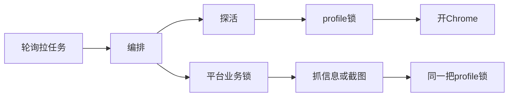

# Python 探活卡住浏览器锁：用约 150 秒整体超时避免服务假死

## 项目背景

我负责开发一个处理「投诉链接」的 Python 服务。

它的主要流程并不复杂：Java 向任务池写入链接，Python 轮询领取任务。每条链接通常要完成两类工作，一是抓取标题和互动数，二是生成几张模拟举报成功的截图，最后把结果回调给 Java。

进程中常驻两条 asyncio 循环，一条处理基础信息，一条处理截图，两者共用同一个事件循环。如果其中一条业务协程长时间停在某个 `await`，相关任务就无法继续推进。从外部看，进程还在，日志却不再更新，很像整个服务卡死了。

故障发生前，单条任务大致按下面的顺序处理：

```python
# 1. 清洗 URL
# 2. 探活：链接是不是已经 404 / 失效
# 3. 拿平台业务锁，避免同平台任务互相踩
# 4. 真正开浏览器抓页 / 截图（这里有阶段预算，大约 3～8 分钟）
```

这里的探活不只是发一次 HEAD 请求。为了使用各平台已有的登录 Cookie，探活也会通过 Playwright 打开对应平台的 Chrome 用户目录，也就是 profile。两个 Playwright 实例同时写入同一个 profile，可能破坏登录状态，所以外层加了一把 `asyncio.Lock`：

```python
# browser_profile_lock.py（示意）
async_lock = _async_platform_locks.setdefault(platform, asyncio.Lock())

async with async_lock:
    # 拿到锁之后，才允许启动 / 关闭该平台的 Chrome
    yield
```

探活和截图都要经过这把锁。同一平台、同一时刻，只允许一条路径真正启动浏览器。



问题就出在这里：探活进入这条串行路径后，整段流程没有总体超时。

## 问题现象

线上最先出现的现象不是异常堆栈，而是服务假死。进程仍在运行，日志停在某个时间点，Java 侧的基础信息和截图任务不断积压。值班同学观察到，懂车帝截图任务较多时更容易出现。

下面这段日志的时间间隔很明显。`10:11:30` 还在认领任务，下一条相关日志已经到了 `10:12:30`，中间整整一分钟没有进展。随后 HEAD 请求超时，GET 请求则提示浏览器已经关闭：

```text
20260724 10:11:30 | [open-pull][base-info] 拉到任务 task_id=29438 ...
20260724 10:11:30 | URL 处理完成 link_id=29438 原始=http://www.toutiao.com/video/...
20260724 10:12:30 | (link_http_probe) HEAD 超时 url=http://www.toutiao.com/item/...
20260724 10:12:30 | GET 失败 ... Target page, context or browser has been closed
```

日志停止不代表事件循环已经退出。asyncio 服务中更常见的情况是，循环还在运行，但某条业务协程一直等在 `await` 上。当前任务无法结束，串行依赖它的后续任务也就无法执行。

本地关闭进程时还能看到另一个现象：探活和截图正在竞争同一套懂车帝浏览器，驱动连接被中断。

```text
INFO:     Shutting down
... HEAD 失败 ... Target page, context or browser has been closed
... Connection closed while reading from the driver
Exception: Page.evaluate: Connection closed while reading from the driver
```

这说明浏览器生命周期与探活流程联系得很紧，但仅凭这些日志还不能确定具体卡在哪一步。

## 排查过程

最开始怀疑的是协程中混入了同步网络调用，例如同步上传 OSS 或下载头像。这类调用会阻塞整个事件循环，定时器和心跳也会一起停下。

我们先在事件循环中增加了一个每两秒执行一次的心跳。故障期间，心跳始终保持约两秒一次，说明事件循环仍在工作，可以排除同步代码阻塞 loop。

接着检查 Chrome 的启动和关闭过程，以及页面 DOM 监听是否拖住了渲染进程。补充启停边界日志后发现，浏览器多数时候能在几秒内完成启动和关闭，懂车帝截图也能正常生成并上传，因此这条线索也不是主因。

我们还检查了 `asyncio.to_thread` 使用的默认线程池，确认工作线程很少、队列为空，可以排除线程池被阻塞 HTTP 请求占满的情况。

随后发现了一个不对称现象：截图循环仍在持续拉取任务，并且很快得到「没有任务」的结果；基础信息循环却停在「开始执行」之后，迟迟没有对应的「执行结束」。这说明不是整个进程无法拉取任务，而是基础信息协程卡在了执行过程中。

于是我们继续在编排层补充成对日志，分别记录探活开始与结束、获取平台锁、handler 返回。故障复现时，最后一条日志停在「准备探活」，平台是懂车帝，十几分钟后仍然没有「探活结束」。

至此，范围收敛到了探活流程。

这次排查中，两类日志最有用：心跳用来区分「事件循环停止」和「单条协程挂起」，成对的进入、离开日志用来把问题从「任务不再处理」缩小到具体函数。两种现象在外部都表现为日志停滞，但排查方向完全不同。

## 根因定位

代码中的问题比较直接：探活位于平台业务锁和阶段预算之外。它需要先获取 profile 锁、启动 Chrome，再发送 HEAD/GET 请求。HEAD 和 GET 各自有超时，默认约 60 秒，但「等待锁、启动浏览器、发送请求、关闭浏览器」这一整段没有外层硬超时。相比之下，真正执行抓取和截图的阶段反而有约 3～8 分钟的预算。

最终形成了下面这条阻塞链路：

```text
探活卡住
  → 长时间占用 profile 锁
  → 同平台的截图和基础信息任务在锁外等待
  → 当前基础信息任务无法结束
  → 基础信息循环不再领取新任务
```

从服务外部看，这就是一次假死。实际复现时，探活可以卡住十几分钟。

编排顺序大致如下：

```python
# orchestrator._dispatch（摘录）

# 先探活。会开浏览器、拿 profile 锁。
# 修复前：这里没有整体 wait_for，最坏可以挂很久。
await assert_complaint_url_http_alive(platform_key, complaint_id, cleaned_url)

# 再拿平台业务锁，真正干活。
# 这里才有阶段预算（base-info ≈ 180s，截图更长）。
async with _lock_for(platform_key):
    result = await execute_with_phase_deadline(
        phase, _run_handler, budget_s=budget_s
    )
```

修复前，探活内部大致是这样：

```python
# 修复前（示意）
async with complaint_browser_page(platform_key, complaint_id=complaint_id) as page:
    # 单次 HEAD / GET 有 timeout_ms（默认 60_000）
    # 但「拿锁 + 启动 Chrome + 关闭」不在这个 timeout 里
    status = await fetch_main_navigation_status(page, url, timeout_ms=60_000)
```

Playwright 为 HEAD/GET 设置的 timeout 只约束单次请求，不包括等待 profile 锁和启动 Chrome。因此，即使单次请求的超时是 60 秒，整段探活仍可能等待很久。

外层使用 `asyncio.wait_for` 后，超时会取消内部 Task。`wait_for` 会等待取消过程完成，`async with` 的 `__aexit__` 随后执行并释放锁，因此实际返回时间可能略高于设定值，但资源可以沿着正常的清理路径回收。

这里还有一个结构性风险。探活先获取 profile 锁；正式处理则先获取平台业务锁，再进入 profile 锁。两条路径的加锁顺序不同，存在交叉等待的可能。这次的直接证据指向探活缺少整体超时，统一锁顺序属于后续加固范围，不在本次修复中。

## 修复方案

修复内容集中在探活函数：使用 `asyncio.wait_for` 包住完整探活流程。

默认超时由两次请求预算和 30 秒浏览器开销组成。`timeout_ms` 默认为 `60_000`，因此整体预算为 `60 × 2 + 30 = 150` 秒，也可以通过环境变量 `COMPLAINT_PROBE_OVERALL_TIMEOUT_S` 覆盖。

修复前，探活可能卡住十几分钟，并一直占用 profile 锁；修复后，达到约 150 秒的整体预算便开始取消探活，完成清理并释放锁，让任务流水线继续运行。

超时后的业务处理也需要明确。探活只是提前发现失效链接的优化手段，不应成为最终判定依据。因此，整体超时后只记录日志并放行，由后续正式抓取再次确认，避免把浏览器或网络的短暂异常误判为「链接已失效」。

```python
def _probe_overall_timeout_s(timeout_ms: int) -> float:
    # 可用 COMPLAINT_PROBE_OVERALL_TIMEOUT_S 覆盖
    # 默认：两次请求预算 + 30s 浏览器开销
    # 60_000ms → 150s
    return (timeout_ms / 1000.0) * 2 + 30.0


async def assert_complaint_url_http_alive(...):
    async def _probe_status() -> int | None:
        # complaint_browser_page 内部会：
        # 1) async with complaint_profile_lock(...)
        # 2) 启动 persistent Chrome
        # 3) yield page；退出时关闭并释放锁
        async with complaint_browser_page(platform_key, complaint_id=complaint_id) as page:
            return await fetch_main_navigation_status(
                page, text, timeout_ms=timeout_ms
            )

    overall_timeout_s = _probe_overall_timeout_s(timeout_ms)
    try:
        # 超时会 cancel _probe_status
        # cancel 后 async with 退出，锁才能还回去
        status = await asyncio.wait_for(
            _probe_status(), timeout=overall_timeout_s
        )
    except asyncio.TimeoutError:
        _logger.warning(
            f"(link_http_probe) 探活整体超时，跳过判定并放行 "
            f"platform={platform_key} id={complaint_id} "
            f"timeout_s={overall_timeout_s}"
        )
        return  # 未判定存活，交给后面的正式处理

    if is_dead_http_status(status):
        raise ComplaintAbortError(FailureCode.LINK_INVALID, ...)
```

这与正式处理阶段已有的预算机制是同一种思路：只要一条路径会长时间占用共享浏览器资源，就必须设置可取消的边界，并确保取消后能够释放锁。

## 复盘

本地单次运行探活时，获取锁通常很快，Chrome 几秒内就能启动，HEAD 请求也有 60 秒超时，很容易让人误以为整条链路的耗时已经受控。但生产服务会长期运行，网络抖动、浏览器异常、锁等待和进程重启都会发生。单次请求有超时，不等于整个业务流程有上限。

本地验证关注的是链路能否正常完成，常驻服务还要考虑异常发生后能否自行恢复。探活本身只是一个辅助步骤，但它和截图共用 profile 锁。一旦探活无法退出，影响就会沿着共享资源扩散到后续任务。

因此，长期运行的异步服务需要把超时、取消、资源释放和失败策略明确写进执行路径。本次修复给探活增加了约 150 秒的总体预算，核心目的不是让失败更快，而是限制共享资源被占用的时间，避免单个异常拖住整条流水线。

日志同样是这次定位的关键。心跳证明事件循环仍在运行，成对的边界日志则把卡点定位到探活函数。发生假死时，现场堆栈未必能保留下来，能反映执行进度的日志往往是最直接的证据。

目前仍有一项后续工作：统一平台业务锁和 profile 锁的获取顺序。如果问题再次出现，应优先消除交叉加锁；另一种方案是让探活使用不占登录 profile 的轻量请求，从资源层面拆开探活与截图。整体超时解决了无上限等待的问题，但锁顺序仍值得单独治理。
