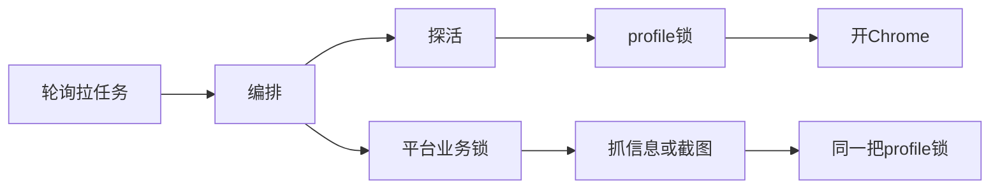

# Python 探活卡住浏览器锁导致假死：悲观面对生产环境，积极做好异常处理

## 项目背景

我正在负责开发一个处理「投诉链接」的 Python 服务。

这个Python程序的主要功能，用人话来说就是：Java 往任务池丢链接，Python 轮询拉取。每条链接一般干两件事：抓标题和互动数，再截几张模拟举报成功的图，最后回调回去。

进程里常驻两条 asyncio 循环。一条拉基础信息，一条拉截图。共用同一个事件循环。所以某一条协程如果卡死在 `await` 上出不来，表面上就像「整机假死」——其实循环可能还在转，只是关键路径被堵住了。

在出事之前，这个程序处理单条任务时，顺序大概是这样：

```python
# 1. 清洗 URL
# 2. 探活：链接是不是已经 404 / 失效
# 3. 拿平台业务锁，避免同平台任务互相踩
# 4. 真正开浏览器抓页 / 截图（这里有阶段预算，大约 3～8 分钟）
```

探活容易被想成「发个 HEAD 就行」。我们不是。为了带上各平台已经登录好的 Cookie，探活也会用 Playwright 打开该平台的 Chrome 用户目录。这个目录叫 profile。两个 Playwright 同时写同一个 profile，很容易把登录态写坏，所以外面套了一把 `asyncio.Lock`：

```python
# browser_profile_lock.py（示意）
async_lock = _async_platform_locks.setdefault(platform, asyncio.Lock())

async with async_lock:
    # 拿到锁之后，才允许启动 / 关闭该平台的 Chrome
    yield
```

探活要过这把锁。截图也要过。同一平台同一时刻，真正开浏览器的路径只能有一个。像单行道。



假死，就出在这条单行道的入口：探活占着道，自己却几乎没有「整段超时」。

## 问题原因

线上先看到的不是漂亮堆栈，是假死。进程还在。日志停在某一秒，不再往前滚。Java 那边基础信息和截图越堆越多。值班同学感觉，懂车帝截图一多，就更容易撞上。

有一份日志时间感很清楚。`10:11:30` 还在认领任务。下一跳相关日志直接跳到 `10:12:30`。中间空了整整一分钟。然后探活报 HEAD 超时，GET 说浏览器已经关了：

```text
20260724 10:11:30 | [open-pull][base-info] 拉到任务 task_id=29438 ...
20260724 10:11:30 | URL 处理完成 link_id=29438 原始=http://www.toutiao.com/video/...
20260724 10:12:30 | (link_http_probe) HEAD 超时 url=http://www.toutiao.com/item/...
20260724 10:12:30 | GET 失败 ... Target page, context or browser has been closed
```

日志停了，不等于事件循环死了。asyncio 里更常见的是：循环还在转，某条业务协程卡在 `await` 上。它出不来，后面依赖它的活也就干不成。

本地关进程时，还能撞见另一面。探活和截图抢同一套懂车帝浏览器，驱动连接被掐断：

```text
INFO:     Shutting down
... HEAD 失败 ... Target page, context or browser has been closed
... Connection closed while reading from the driver
Exception: Page.evaluate: Connection closed while reading from the driver
```

这说明浏览器生命周期和探活缠得很紧。至于到底堵在哪一步，还要再挖。

## 排查经过

第一反应很俗：是不是有人在协程里跑了同步网络调用？比如同步上传 OSS、同步下头像。那种情况会把整个事件循环堵住。定时器、心跳也会一起停。

我们在循环里加了个每两秒跳一次的心跳。假死窗口里它一直约两秒一跳。事件循环活着。「同步代码卡死 loop」先关掉。

接着怀疑 Chrome 启动或关闭挂死，或者页面上的 DOM 监听把渲染进程拖垮。在启停和截图完成处打了边界日志。多数时候启动关闭是秒级。懂车帝截图也能跑完并上传。也不像主因。

再怀疑 `asyncio.to_thread` 的默认线程池被挂死的 HTTP 占满。心跳里顺带看了池子：工作者很少，队列为空。否了。

然后出现一个不对称。截图那条循环还在空转拉任务，很快拿到「没有」。基础信息那条却停在「开始执行」之后，很久没有「执行结束」。不是整个进程拉不动。是基础信息这条协程卡在执行途中。

再往编排层拆成对日志：探活前 / 探活后 / 拿到平台锁 / handler 返回。复现时最后一条停在「准备探活」，平台是懂车帝。之后十几分钟都没有「探活结束」。

卡点落到探活。

回头看，有两招特别管用。用心跳区分「循环死了」和「某条 await 挂了」——表象都是日志停，机理完全不同。用成对的进入/离开日志，把「拉不到任务」收敛到具体函数。没有这两步，很容易在 OSS、拼图、页面 DOM 上绕很久。

## 定位问题

把代码摊开，原因其实不玄。

探活写在平台业务锁和阶段预算之外。它一进场就要拿 profile 锁、开 Chrome，再发 HEAD/GET。HEAD/GET 各自有超时，默认大约 60 秒。但「等锁 + 启动浏览器 + 发请求 + 关浏览器」这一整段，当时没有外层硬超时。真正干活的抓取/截图反而有大约 3～8 分钟预算。预算罩不住探活。

于是链路就变成这样：探活卡住 → 一直握着 profile 锁 → 同平台后面的截图和基础信息都在锁外排队 → 基础信息循环因为当前这条出不来，也不再去拉新任务。外面看，就是假死。复现时这一卡住能拖十几分钟。

编排顺序大概是这样：

```python
# orchestrator._dispatch（摘录）

# 先探活。会开浏览器、拿 profile 锁。
# 修复前：这里没有整体 wait_for，最坏可以挂很久。
await assert_complaint_url_http_alive(platform_key, complaint_id, cleaned_url)

# 再拿平台业务锁，真正干活。
# 这里才有阶段预算（base-info ≈ 180s，截图更长）。
async with _lock_for(platform_key):
    result = await execute_with_phase_deadline(
        phase, _run_handler, budget_s=budget_s
    )
```

修复前，探活内部大致是这样：

```python
# 修复前（示意）
async with complaint_browser_page(platform_key, complaint_id=complaint_id) as page:
    # 单次 HEAD / GET 有 timeout_ms（默认 60_000）
    # 但「拿锁 + 启动 Chrome + 关闭」不在这个 timeout 里
    status = await fetch_main_navigation_status(page, url, timeout_ms=60_000)
```

这里有个异步里很实在的细节。Playwright 给 `head` / `get` 设的 timeout，只管这一次请求。等锁、启动 Chrome，不在里面。你以为最慢也就 60 秒，实际可能在锁或启动上挂很久。

而 `asyncio.wait_for` 超时后会取消里面的 Task，并等到取消做完。`async with` 的 `__aexit__` 才会跑，锁才会被放掉。没有这层取消，单靠内层请求超时，锁可能一直握着。

还有一层结构风险。探活先抢 profile 锁；真正干活时先抢平台业务锁，再进 profile 锁。两把锁，两种顺序。这是教科书里的交叉等待写法。这次线上证据更直接指向「探活没有整体超时」。锁序统一是后续该做、这次还没做的加固。

## 修复措施

改动就在探活函数上。给整段探活包一层 `asyncio.wait_for`。

默认超时算得很直白：两次单次请求预算，再加 30 秒浏览器开销。默认 `timeout_ms=60_000`，整体就是 `60 * 2 + 30 = 150` 秒。也可以用环境变量 `COMPLAINT_PROBE_OVERALL_TIMEOUT_S` 覆盖。

量化一下对比：修复前，探活卡住可以拖十几分钟甚至更久，profile 锁一直不放；修复后，最坏大约 150 秒取消探活、释放锁，流水线继续往下走。

超时后怎么处理也要想清楚。探活本来只是「快点发现死链」的优化，不是最终裁决。所以超时后不判链接失效。只打日志，然后放行，让后面的正式抓取再试。避免把浏览器或网络抖一下，写成业务上的「链接已失效」。

```python
def _probe_overall_timeout_s(timeout_ms: int) -> float:
    # 可用 COMPLAINT_PROBE_OVERALL_TIMEOUT_S 覆盖
    # 默认：两次请求预算 + 30s 浏览器开销
    # 60_000ms → 150s
    return (timeout_ms / 1000.0) * 2 + 30.0


async def assert_complaint_url_http_alive(...):
    async def _probe_status() -> int | None:
        # complaint_browser_page 内部会：
        # 1) async with complaint_profile_lock(...)
        # 2) 启动 persistent Chrome
        # 3) yield page；退出时关闭并释放锁
        async with complaint_browser_page(platform_key, complaint_id=complaint_id) as page:
            return await fetch_main_navigation_status(
                page, text, timeout_ms=timeout_ms
            )

    overall_timeout_s = _probe_overall_timeout_s(timeout_ms)
    try:
        # 超时会 cancel _probe_status
        # cancel 后 async with 退出，锁才能还回去
        status = await asyncio.wait_for(
            _probe_status(), timeout=overall_timeout_s
        )
    except asyncio.TimeoutError:
        _logger.warning(
            f"(link_http_probe) 探活整体超时，跳过判定并放行 "
            f"platform={platform_key} id={complaint_id} "
            f"timeout_s={overall_timeout_s}"
        )
        return  # 未判定存活，交给后面的正式处理

    if is_dead_http_status(status):
        raise ComplaintAbortError(FailureCode.LINK_INVALID, ...)
```

这和后面正式处理已经在用的阶段预算是同一思路。凡是会长时间占着共享浏览器资源的路径，都必须能被取消；取消后必须能把锁还回去。

## 复盘总结

本地跑通一次探活，很容易默认：拿锁很快，Chrome 几秒就起来，HEAD 最慢也就六十秒。但生产里不是这样。同一套代码要连着跑很久，网络会抖，浏览器会僵，锁会排队，进程还会被重启打断。乐观估计执行速度和稳定性，本质上是在用 demo 的体感给生产做承诺。

本地 demo 和生产长期稳定运行，有本质区别。demo 关心「这条链路能不能通」。常驻服务关心「不通的时候会不会把整条流水线拖死」。探活在本地看起来只是个小优化；线上它和截图共用 profile 锁，一旦挂住，后面的任务一起停。局部成功，不代表系统可维护。

所以长期运行的系统，得有一套应对异常的策略和约束，不能靠「正常路径多半顺利」。超时、取消、锁释放、失败后放行还是告警，都要事先写进路径里。这次修的就是约束：探活最坏大约 150 秒必须放手，不能无限握着浏览器锁。约束看起来保守，但它把故障半径按住了。

日志在这件事里帮了大忙。没有心跳，我们可能一直以为事件循环死了。没有进入/离开成对日志，卡点也很难从「拉不到任务」收敛到「探活」。假死发生时，堆栈不一定还在，进度日志往往是唯一线索。日志不是装饰，是生产环境的黑匣子。

技术上仍有一刀没砍：两把锁的获取顺序还没统一。如果假死再现，应优先处理锁序，或者让探活改成不占用登录 profile 的轻量请求，把探活和带登录态截图从资源上拆开。悲观一点看生产，积极一点写异常路径——比再信一次「应该很快」靠谱。
