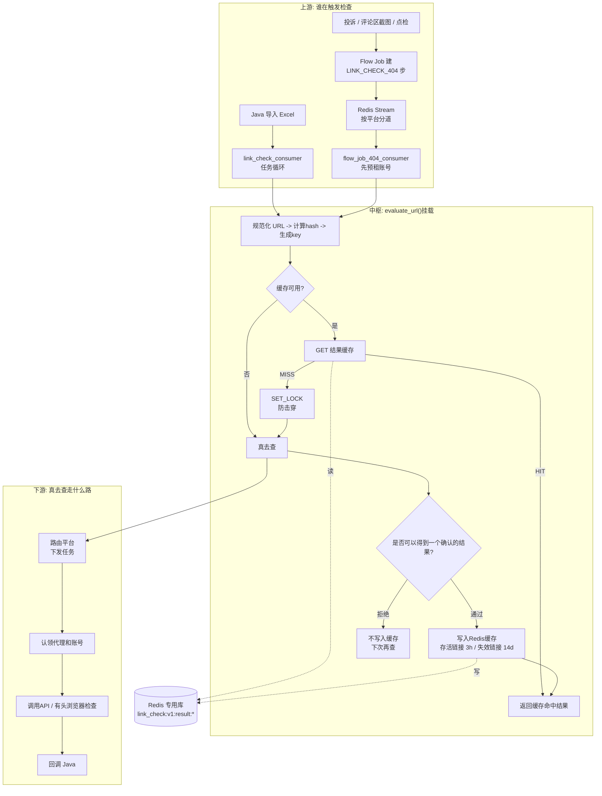

# 如何设计一个可靠的Redis缓存系统——开发缓存系统的心得

上周，又或许是上上周的时候，老大将许久之前的需求提上了日程，并通过du哥（隐去真名，用姓氏的拼音首字母取代）委派给我来完成。

在这个AI Coding接管一切，好像一句话就能生成缓存系统的时代，我反而有一些些谨慎。在我过去半年的实习开发的经验和个人理解中，业务系统挂掉的危害相比于基建来说要小的多。而且，这个缓存系统的上下游的压力并不小，如果在我这里出问题，事故的后果是我背负不起的。正因如此，设计一个可靠的Redis缓存系统，势在必行，而且容不得马虎。

> *豆包，帮我生成一个可靠的Redis缓存系统。*

## 项目背景

简单来说，我司的其中一项（多项）业务中，需要对来自互联网上各家媒体（从传统的电子纸媒到各种自媒体平台）的帖子数据进行收集和处理，从转发、评论、点赞的互动数据到评论区的风向舆情。对那些动辄营销预算百万千万的行业巨头来说，了解到大众的喜恶是至关重要的，而我们就是这个链条上的一环。

但学过计算机的都知道，对信息的加工处理存在一个必然的**大前提**，它确实存在。

在缓存系统的需求诞生前，大部分时候，链接的存在性检查是由合规的自建、或托管的Python爬虫消费者来驱动的。我们设计了大量、多样的抓取和判读策略，确保绝大多数的平台都可以纳入其中，顺利的完成相关的检查工作————回答一个问题：链接是真的被下线了，还是好好的存在？

但仍然有少量平台，通过传统的有头、无头浏览器+`Playwright`并不能准确的判读，包括但不限于**封IP，封浏览器指纹，奇奇怪怪的验证码，网速太慢加载失败等等，网页版更新**，所以我们也有尝试使用到一些三方API来获取这些信息。

但请求API意味着成本，据估算，平均请求一次链接的API成本在1毛钱左右，如果一天要处理5000条媒体链接，即便只有50%的媒体链接需要API请求来确认，也意味着高达250元一天的成本。而且，请求API也不能保证100%的可达性，这对我们的交付是一个很大的挑战，你也不想自己开发的系统天天出问题吧？

金钱成本只是一个方面，我们在不断的开发中，深刻的意识到，时间成本的威力也比想象中要大。在我们先前的日志统计中，平均每条链接的处理时长在13s-15s左右，而这还是我们尽可能的优化执行策略，压榨爬虫的执行效率后的结果（Chrome异步锁，多账号租借系统，多Worker并发，服务器扩容等），很多链接往往需要30s以上才能完成。如果项目组一次导入3000条链接（在项目组，这个数字只能说稀松平常），那么平均等待时间竟有10h之多。这种状况持续下去，迟早有一天会出现系统速度不如人工手点确认的情况。

时间成本的挤压，不仅仅来自数量，还有一个同样甚至更加严峻的层面————重复投递。

我们公司的客户存在长期维护的需求，一般来说是一天两次的定时汇报，这就意味着相同的链接，即便已经被下线了，在上午要检查一次，下午又会被检查一次，由此产生的时间浪费也不容小觑，我这么说，自然是因为这里有个最直接、最扎心、最不绕弯子的业务语境：**一个链接被下线了，便再无被复活的可能。**

好了，到现在我们基本可以总结一下，我们为什么需要这样一个缓存系统：节约调用API的经济成本，节省反复检查的时间成本。

> 除此之外，正如开篇前对我司业务的概述，有许多其他的业务也高度依赖链接有效性检查的功能，因此还间接节约了其他业务的耗时。

## 如何设计

如果现在去问豆包或者大肥鱼，如何设计一个可靠的Redis缓存系统，她一定说的头头是道。但问题是，现实世界并不总是需要全盘照搬最佳实践，开发成本、迁移成本、机器性能、业务规模等都是很重要的背景因素，比起一步到位，把一些问题厘清的价值更为重要，这也是`trade-off`的含义。后文中出现`trade-off`标识，便说明我在技术与业务之间的一些思考和权衡。

### 架构

总体架构:


1. 上游：

上游主要是来自两个位置的输入，一个是通用的接口，通过Redis消息队列下发相关的Task Message，通过相关的Consumer认领，获取到任务数据。
另外一个是早就搭建好的独立功能服务，以常驻进程的形态存在，采用的是Java后端 轮询 RESTful API方式，每30s轮询请求一次任务；若暂无新任务，则冷却等待30s后再次尝试请求。

2. 中枢：

两条入口最后都调同一个方法：`LinkCheckWorker.evaluate_url`，我们在设计的时候把缓存挂在统一的方法入口，两条上游入口自动都受益。其他模块完全不知道，也不需要知道缓存的存在，它只管调 `evaluate_url()`，这样就确保了幂等性。

- **计算链接哈希**

预处理是绝对必要的，我们针对已有的平台做了特殊的处理，确保无论输入的长链接还是短链接还是奇奇怪怪的口令，最终都转换为一个规范、统一的，遵循URL标准的http/https链接。

链接计算好之后做 SHA-256 哈希，形成了一个规范的缓存key：`link_check:v1:result:{平台}:{身份哈希}:{策略版本}`

- **检查链接缓存**

在计算得到该清洗链接的哈希值后，Redis的本职功能————缓存，终于可以排上用场了

- 查到（HIT）：命中KV，直接返回对应的值，不再调用API
- 没查到（MISS）：继续往下走，去真实的查询。

3. 下游

负责具体的查询逻辑，如何查询的策略在此处略去，在添加缓存系统后，不同之处在于，在拿到链接的检查结果后，只要最终检查结果是明确的，就按照存活链接保存3h，失效链接保存14d的策略，将检查结果缓存进系统。


### 细节

刨去将缓存系统与业务相结合的过程，在设计缓存系统本身也有许多需要注意的细节，这些问题经常被忽略和系统“默认”，甚至有些老生常谈，却直接会影响到系统到底能不能靠得住，当AI忘记这些问题的时候，你能不能主动提起然后和AI探讨，得出答案。

#### 缓存雪崩

**缓存雪崩**：大量 key 同时过期，数据库压力瞬间打爆

如果大量缓存key在同一时间集体过期，大量请求同时落到数据库，数据库瞬间负载飙升，甚至宕机；数据库挂了之后，更多请求失败，连锁引发服务雪崩。

在本项目中，我设计的缓存KV的TTL（Time To Live,即生存时间）为3h/14d，如果出现大量同一时间过期的，不仅会导致Redis的压力陡增，更有可能触发缓存雪崩拖垮整个系统的服务。

解决策略：
1. **过期时间加随机偏移量**：给TTL增加随机值，打散过期时间，避免大批量 key 同一时刻过期。
2. **数据库分离**: 本项目的Redis数据库是自托管的，与线上环境的ECS服务和阿里云的RDS严格分离，确保单个Redis崩溃不会拖垮服务
3. **Redis主从架构[trade-off]**: Redis 主从 + 哨兵 / Redis Cluster，避免单点宕机导致全量缓存失效，理论效果更好但受限于成本，实际未采纳。

> 这么好的架构，你怎么不早点告诉我？

``` py

def jittered_ttl_seconds(base: int, ratio: float, *, rng: random.Random | None = None) -> int:
    """
        生成带抖动(Jitter)的缓存过期时间，用于打散 key 的过期时刻，预防缓存雪崩。

        在基准 TTL 的 [base*(1-ratio), base*(1+ratio)] 区间内随机取值。

        Args:
            base: 基准 TTL，单位秒
            ratio: 抖动比例，>=0；ratio=0 时直接返回 base
            rng: 可选随机数生成器，传入可固定种子用于测试

        Returns:
            int: 抖动后的 TTL 秒数，最小为 1

        Example:
            >>> jittered_ttl_seconds(base=1800, ratio=0.1)  # 1620 ~ 1980 秒
        """

    source = rng or random
    jitter_ratio = max(0.0, float(ratio))
    if jitter_ratio == 0:
        return max(1, int(base))
    ttl = int(base * (1.0 + jitter_ratio * (2.0 * source.random() - 1.0)))
    low = math.floor(base * (1.0 - jitter_ratio))
    high = math.ceil(base * (1.0 + jitter_ratio))
    return max(1, min(max(ttl, int(low)), int(high)))

```

#### 缓存穿透

**缓存穿透**：查询**不存在的数据**，请求直接打到数据库

实际上，这个情况在我们实际业务运行中遇到的可能性不大，原因要从缓存穿透的成因说起。缓存穿透的典型场景是**恶意攻击或参数异常**：有人拿着随机构造、根本不存在的 key 疯狂请求，而正常的缓存逻辑是"查不到就不写缓存"，于是这些查询每次都绕过缓存直接压到后端存储上。

但放到本项目的语义里，这个前提是不成立的：

1. **key来源于真实业务**：缓存的 key 是由上游引入的媒体链接经过规范化 + SHA-256 哈希得到的，这些链接来自客户长期维护的帖子清单、投诉和点检工单，是一条条真实存在于互联网上的帖子。攻击者既不知道我们内部有这套缓存，也无法通过构造任意字符串来命中缓存 key 的计算路径——非 URL 规范的输入在预处理阶段就被规整或淘汰了。

2. **"不存在"这个概念在本系统里不成立**：对一条链接来说，检查结果只有两种有意义的结论——**存活**或**失效**，分别是"确有其事"的两个方面。哪怕是被删掉的链接，对我们来说也是一条**有效的、需要被记下来的结论**（缓存14d）。所以系统中并不存在"查了发现什么都没有、因此没法写缓存"的这种空结果，也就不存在空的 key 被反复查询的空间。

3. **真正未命中缓存的请求，往往是第一次查询**：MISS 的情况基本发生在链接首次被检查、或缓存已过期时，这些都是**正常且必要**的真实查询，有真实的查询结果可供落盘，不存在"永远查不到、只能一遍遍穿透"的情况。

4. **后端本就具备抗重复查询的能力**：即便偶尔出现少量非预期的高频 MISS，下游的查询链路本身是"多账号 + 代理 + 分道消费者"的异步任务体系，并不像关系型数据库那样会被几个并发请求瞬间打垮，对重复查询的容忍度相对更高（当然，这也是通过 `SET_LOCK` 防击穿进一步缓解的，见下一节）。

综上，本系统的 key 空间是**封闭且来源于真实业务**的，且"查得到结论就落缓存"这一策略保证了每一次真实查询都会留下痕迹，因此并不符合"不存在的 key 被反复穿透"这一缓存穿透的典型前提。这也是我们没有专门引入空值缓存 / 布隆过滤器来防穿透的根本原因（下节会展开说明 trade-off）。

解决策略：


1. **不设置缓存空值[trade-off]**：所谓缓存空值，是指查询未命中时，把一个“查不到/不存在”的空结果也写进缓存并设置一个较短TTL，用来拦住反复穿透到后端的请求。我们不这么做，是因为本系统的缓存语义是“确有其事我才记”——只有拿到明确结论（链接存活或失效）才落缓存，任何不确定、被拒绝、异常返回的结果都坚决不写。
这样做的代价是需要容忍一部分重复查询，换来的是缓存里永远没有**脏数据**：一旦写了空值，就等于把一个尚未证实的判断固化了，极有可能出现上次查询时还没问题，下次查就已经失效的链接。宁可下次再查，也不能把一个可能是错的“不存在”当成结论。

2. **不设置布隆过滤器[trade-off]**：布隆过滤器适合在“全量数据集合已知且有限”的场景下，用很小的内存代价快速判断 **“某元素一定不存在”** 或 **“可能存在”** ，用来在前面挡住大量本该不存在的查询。
我们的场景并不满足这个前提：链接的集合是开放的、不断由互联网动态新增的，我们事前根本拿不到一个全量可枚举的集合去预先设置进过滤器；而且，判断一个链接“还在不在”本身就要走真实的查询链路，布隆过滤器只能说“可能存在/一定不存在”，无法给出业务真正需要的“存活还是失效”的确定结论。再加上引入布隆过滤器还要额外维护组件、处理误判率和数据同步，收益远不及开发与运维成本，因此不做。

*关于布隆过滤器，这里有相关的介绍：*

> **布隆过滤器：**
>
> 布隆过滤器是一种**空间效率极高的概率型数据结构**，由 Burton Bloom 于 1970 年提出，用于判断一个元素**是否存在于集合中**。它的核心特性是：
>
> - 判断“**不存在**” → **一定不存在**（不会漏报）
> - 判断“**存在**” → **可能存在**（有一定误判率）
>
> 它用极小的内存和`O(k)` 的查询速度，换取了对“可能误判”的容忍。
>
> **工作原理**：底层是一个长度为 **m 的位数组**（初始全为 0）和 **k 个相互独立的哈希函数**。插入元素时，用 k 个哈希函数算出 k 个哈希值，对 m 取模后把对应的 k 个位全部置 1；查询时用同样的方式算出 k 个位置，**只要有一位为 0 就说明元素一定不存在**，**全部为 1 则说明元素可能存在**（这些位也可能是被其他元素“凑巧”覆盖的，即误判）。简单示例（m=10）：
>
> ```
> 插入 "apple":  哈希得到位置 2, 5, 7   → 位数组:[0,0,1,0,0,1,0,1,0,0]
> 插入 "banana": 哈希得到位置 3, 5, 8   → 位数组:[0,0,1,1,0,1,0,1,1,0]
>
> 查询 "cherry": 位置 2, 7, 9 → 位置9是0 → 一定不存在 ✓
> 查询 "grape":  位置 3, 5, 7 → 全是1   → 可能存在（可能是误判）
> ```
>
> **误判率与参数设计：** 	
> p ≈ (1 − e^(−kn/m))^k，其中 n 为已插入元素数量、m 为位数组长度、k 为哈希函数个数；最优哈希函数个数约为 k ≈ 0.7 × (m/n)。典型数据下，**1% 误判率时每个元素只需约 9.6 bit**，且与元素本身大小无关——存 1000 万个 URL 只需约 12 MB，这是哈希表无法比拟的。
>
> **典型使用场景**：缓存穿透防护（最经典，不存在的 key 直接拦截）、爬虫 URL 去重、推荐系统去重（如抖音、知乎判断是否已看过）、数据库/存储引擎（HBase、Cassandra、LevelDB/RocksDB 用于减少无效磁盘 IO）、黑名单过滤（垃圾邮件、Chrome 恶意网址检测）、注册查重等。工程实现可参考 Guava 的 `BloomFilter`、Redis 的 RedisBloom 模块。
>
> 使用限制：
>
> 1. **存在误判（假阳性）**：只适用于“误判代价低”或“宁可错杀”的场景，例如缓存穿透防护中误判只是多查一次数据库；但“账号是否存在”这类强一致性场景就不合适，且误判率会随元素增多而上升。
> 2. **无法删除元素**：删除时把某个位清 0 会影响共享该位的其他元素，导致它们被误判为“不存在”；若需删除，可用**计数布隆过滤器**（用计数器代替比特位，占用更多空间）或**布谷鸟过滤器**。
> 3. **不能获取原始数据**：只存储哈希指纹，既不能还原元素，也无法遍历集合内容。
> 4. **容量需要预估**：位数组长度固定，实际插入量远超预估时误判率会急剧恶化（有 Scalable Bloom Filter 变体可自动扩容）。
> 5. **哈希函数质量要求高**：需要 k 个相互独立、分布均匀的哈希函数，否则误判率会明显劣于理论值。
>
> **总结**：布隆过滤器 = 用一点内存 + 允许少量误判，换取“元素绝对不存在”的快速判断能力。它适合做海量数据下的**前置快速筛除**


#### 缓存击穿

**缓存击穿**：**热点 key 过期**，大量并发请求打到数据库

**某一个热点 key**在缓存过期瞬间，大量并发请求同时进来，缓存失效，全部打到数据库。它和雪崩区别：**只有一个 key 失效**，不是一批。

解决方案：

1. **在业务代码上实现`singleflight`**：

> 什么是`singleflight`: 合并并发请求，同一个 key，同一时间段内，只放行 1 个请求去执行耗时操作（查 DB / 远程调用），其他
> 相同 key 的并发请求则阻塞等待，并复用这一次的返回结果。

`singleflight`在业务代码的层面上实现了请求的压缩和归集，避免了瞬时大量请求打到数据库导致的Redis服务器压力陡增。

``` py
"""In-process singleflight so one worker does not stampede the same cache key."""
from __future__ import annotations
import threading
from typing import Callable, TypeVar

# 泛型，用来标记函数返回值类型T
T = TypeVar("T")


class KeyedSingleFlight:
    """
    进程内 SingleFlight 实现（只在同一个Python进程内生效，跨机器无效）
    作用：同一个key，同一时刻，只让1个线程执行耗时函数（查DB/更新缓存）；
    其他并发线程等待，复用这次执行的结果，用来防止缓存击穿（缓存失效时大量并发同时打DB）
    """
    def __init__(self) -> None:
        # 全局锁：保护 _flights 字典的读写（增删查Flight任务）
        self._guard = threading.Lock()
        # 字典：key=业务key；value=_Flight实例，代表这个key正在进行中的任务
        self._flights: dict[str, _Flight] = {}

    def do(self, key: str, fn: Callable[[], T], *, wait_timeout: float) -> T:
        """
        执行singleflight逻辑
        :param key: 要合并请求的唯一标识，一般是缓存key
        :param fn: 耗时回调函数（例如查询数据库、回填缓存），只会被最多1个线程执行
        :param wait_timeout: 等待任务完成的超时时间（秒）
        :return: fn执行成功后的返回结果
        :raises: 会抛出fn执行时产生的异常；等待超时会直接自己执行fn
        """
        # 加锁，检查当前key有没有正在跑的任务
        with self._guard:
            flight = self._flights.get(key)
            if flight is None:
                # 没有任务：新建一个Flight任务对象，放入字典，当前线程成为「任务所有者owner」
                flight = _Flight()
                self._flights[key] = flight
                owner = True
            else:
                # 已经有别的线程在跑这个key了，当前线程不是owner，进入等待逻辑
                owner = False

        if owner:
            # ========== 当前线程是owner：唯一执行fn的线程 ==========
            try:
                # 执行耗时操作（查DB，回填缓存）
                flight.result = fn()
                return flight.result
            except Exception as exc:
                # 如果执行报错，把异常保存到flight里，后面等待的线程会拿到这个异常
                flight.error = exc
                raise
            finally:
                # 标记任务完成，唤醒所有等待这个flight的线程
                flight.done.set()
                # 再次上锁，把这个key从flights字典清理掉，释放内存
                with self._guard:
                    if self._flights.get(key) is flight:
                        del self._flights[key]

        # ========== 非owner线程：等待owner执行完成 ==========
        # 等待事件，最多等待 wait_timeout 秒
        if not flight.done.wait(timeout=wait_timeout):
            # 等待超时！不等了，当前线程自己执行fn（降级策略）
            return fn()

        # 等待成功，任务跑完了。如果任务抛出过异常，这里直接把异常抛给当前等待线程
        if flight.error is not None:
            raise flight.error
        # 正常，直接复用owner的执行结果
        return flight.result  # type: ignore[return-value]


class _Flight:
    """
    代表一次「正在执行的任务」的数据载体。
    同一个key的所有并发线程共享同一个_Flight实例
    """
    def __init__(self) -> None:
        # Event事件：线程间同步信号。done.set() 标记任务完成，唤醒等待线程
        self.done = threading.Event()
        # 保存任务成功的返回结果
        self.result: object | None = None
        # 保存任务抛出的异常
        self.error: BaseException | None = None


__all__ = ["KeyedSingleFlight"]

```
总的来说，`singleflight`解决了单个Python进程内代码的请求合并和归集，但它的作用域仅限于单进程内，如果大量的请求被分派到多个Worker，多个进程尝试请求Redis缓存，仍然不能从根本上缓解缓存击穿的问题。


2. **Redis分布式锁[trade-off]**

为了解决多个Worker（消费者）同时大量请求相同的缓存Key，可以用Redis分布式锁，利用Redis的原子性保证：全局最多一个请求去查询 DB 并回填缓存，其余请求不访问 DB。
在知晓原理的同时，经过技术选型，最终决定使用[Cashews](https://github.com/Krukov/cashews)实现Redis缓存的加锁和解锁，不再尝试手写lua脚本，降低了开发的心智负担和维护成本。

- 加锁
``` redis
SET lock:goods:10001 uuid-xxxx NX EX 30
```
**参数介绍：**
- `NX`：key 不存在才写入（不存在才能抢到锁）
- `EX 30`：锁 30 秒自动过期，**防止服务 crash，锁永远不释放（死锁）**
- `uuid`：随机唯一字符串，标记锁持有者，**用来防止误删别人的锁**

- 解锁
``` lua
if redis.call("GET",KEYS[1]) == ARGV[1] then
    return redis.call("DEL",KEYS[1])
else
    return 0
end
```
*原因:* 如果 A 的锁超时释放，B 拿到锁；A 执行完直接 DEL，会删掉 B 正在持有的锁。**判断+删除**的动作必须原子化，否则会出现锁被误删的严重 bug

- Cashews实现上锁和解锁

`Cashews`支持异步上下文管理器和装饰器调用。

**异步方法:**
``` py
import asyncio
from cashews import cache

cache.setup("redis://redis:6379/0")

async def refresh_goods_cache(goods_id: int):
    lock_key = f"lock:goods:{goods_id}"
    # expire：锁最大持有时间，防止死锁（预估DB查询+写缓存的最大耗时）
    # wait：最多等待多久尝试抢锁；超过时间抛出TimeoutError
    try:
        async with cache.lock(lock_key, expire=10, wait=2):
            # 抢到分布式锁！全局只有1个实例能进入这个代码块
            print("拿到锁，查询DB并回填缓存")
            # 模拟查DB
            data = await query_db(goods_id)
            # 写入缓存（带上jittered ttl，防止雪崩）
            await cache.set(f"goods:{goods_id}", data, expire=1800)
    except TimeoutError:
        # 抢锁超时：别的机器正在刷新缓存，直接返回降级/重试读缓存
        print("抢锁失败，缓存正在刷新")
        return None

```
**装饰器方法:**

``` py
from cashews import cache

cache.setup("redis://localhost:6379/0")

# ttl：锁的有效期；key模板支持函数参数
@cache.locked(ttl=10, key="lock:goods:{goods_id}")
async def load_goods_from_db(goods_id: int):
    # 全局同一goods_id，只会有一个请求进入这里
    print("执行DB查询+回填缓存")
    data = await db.query(goods_id)
    await cache.set(f"goods:{goods_id}", data, expire=1800)
    return data

# 业务入口：缓存击穿标准逻辑
async def get_goods(goods_id: int):
    cached = await cache.get(f"goods:{goods_id}")
    if cached is not None:
        return cached
    # 缓存miss，调用被locked装饰的函数；分布式锁控制全局仅一次DB查询
    return await load_goods_from_db(goods_id)

```

#### 必要的配置

经常被忽略和“默认”但非常重要的配置：

1. `maxmemory`: Redis最大内存，不设置内存你就等着把服务器撑爆吧。
2. `maxmemory-policy`: 超出最大内存后的过期策略,设置为`volatile-lru`，只淘汰设了 TTL 的 key 中最近最少使用的。
3. `socket-connect-timeout`: 指定服务器在执行命令时等待客户端发送请求的时间。如果在这个时间内客户端没有发送任何请求，Redis 服务器将关闭与该客户端的连接。
4. `lazyfree-lazy-user-del / lazyfree-lazy-expire`: 建议打开，删除 / 过期大 key，放到后台异步线程释放内存，避免阻塞主线程导致查询超时。


### 经常被忽略的日志监控

如果能读到这里，说明哥们你也是个人物。

但代价是什么？你自信的使用`ClaudeCode`、`Codex`、`Cursor`、`Trae`还是什么别的AI编程工具写完了这些代码，然后迫不及待的上线了。

结果一天深夜，老大的死亡电话还是找到了你——“**系统怎么挂了？**”

你想辩解，想把锅甩给其他可怜的同事，想上线看看系统到底是什么问题，但是什么也没有。

没有日志，没有分析报告，你甚至都不知道是哪一行出现的问题，甚至都找不到合适的方法来重放错误。

而这，正是我需要特别强调的地方——为Redis缓存系统搭建一个日志监控是极有必要的。

幸运的是，我司在此之前已经初步的搭建好了相关的日志平台，使用的是`OpenObserve+Filebeat`的选型，其中`OpenObserve`是一款开源的全链路日志&可观测性的日志平台,而`Filebeat`则负责原始日志数据的采集、压缩和回传。在此也一并推荐给大家，这套方案非常的全面，非常的好用。

我在设计阶段也考虑到了这些方面，通过特定标记的属性`cache_state=‘HIT’/"MISS"`和相关的事件`link_check_result_cache_lookup`实现了比较正确的追踪，同时，也设计了一组仪表盘用于总体预览。

以下为截图展示的OpenObserve日志和仪表盘截图，供大家学习和分享，而且从图表中可以看到，我们的业务确实存在着明显的峰谷，从侧面来说，也削减了整个系统的运行压力。


### 道和术

在本项目开发中，我也使用了一些第三方的Skills、MCP，在此一并分享出来，只做简单介绍，大家按需自取。

- `Context7 MCP`: 查开发文档资料，`npx skills add https://github.com/upstash/context7 --skill context7-cli`
- `Tavily MCP`: 在线搜索类MCP，`npx skills add https://github.com/tavily-ai/skills --skill tavily-search`
- `OpenSpec`: SPEC Coding范式，系统性梳理和归纳开发需求，特别适合大范围变更的需求，`npm install -g @fission-ai/openspec@latest`
- `OpenobserveAnalystSkill`: 接入`OpenObserve`日志平台，实现AI辅助定位和分析报错日志，[GitHub仓库](https://github.com/chennqqi/openobserve-analyst-skill)

## 尾声

当你读到这里的时候，当初我设计的缓存系统已经上线一个月有余了，不久之后，我也将结束我这段实习，而这个缓存系统可能还会存在很久，继续陪着其他同事完成它自己的既定使命。

在Agent重写一切的时代，就连我自己都时不时的怀疑这样写，还写这么多是否还有意义。

或许，只是我的分享欲在作祟也说不定，至少我现在，还是相信还是有一些人当初选择CS，是因为“好玩”，“有意思”，“很酷”。而不是简简单单的“赚大钱”——写这种东西我也拿不到钱，“缓存系统”这个话题太不潮流了，不够吸引眼球。

如果AI能做到80%，我们是否还有动力去攀爬那剩下20%的尖峰？我不太想上太多深刻的价值和意义。我能做的，只是把今天仍然在趟过的坑，笨拙的拿出来和大家讲一讲，和自己讲一讲，就算被拿去当做训练素材，被蒸馏，其实也无所谓。

仅此而已。
